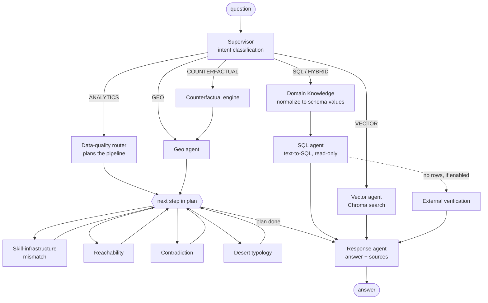

# Medical Desert Query Engine

A LangGraph multi-agent system that answers natural-language questions
about US healthcare facilities: counts and filters (text-to-SQL), semantic
search over facility descriptions, capability/data-quality checks, and
medical-desert and what-if analyses. A supervisor LLM classifies each
question and routes it to the right agents; a response agent writes the
answer with the data sources used.


## How a question flows



- **Domain knowledge first.** Before any SQL is written, an LLM step maps
  informal terms ("heart doctor", "the South") to the dataset's exact
  specialty names and USPS state codes.
- **Analytics as a plan.** The router picks agents by question type (for
  example GeoAgent → Reachability → DesertTypology for "where are the
  deserts?") and the graph runs them in order.
- **Generated SQL runs read-only**, so an LLM-written `DELETE` fails.

Agent details: [`docs/architecture.md`](docs/architecture.md).

## Data

`data/` holds a CMS provider-data extract: 150 facilities (15 in each of 10
states), 7,482 doctors, 7,482 facility–doctor links and 1,100 department
summary rows. On startup the CSVs are loaded into SQLite and the facility
descriptions into an in-memory Chroma collection.

**What the data cannot support.** None of the 150 facility rows has
latitude/longitude, equipment, procedures, specialties or capacity
filled in. As a result:

- distance, proximity and travel-time analysis have no coordinates to use;
  reachability scores come out as 0/100,
- skill-infrastructure mismatch detection has no equipment to compare
  claims against,
- desert typology reports population from a hard-coded per-region table.

These agents run end to end, but their outputs are not meaningful until
the data includes coordinates and equipment.

## Setup

```bash
pip install -r requirements.txt -e .
cp .env.example .env        # set LLM_PROVIDER and its API key
python scripts/demo.py      # interactive demo
```

API:

```bash
uvicorn medical_deserts.api:app --port 8000
curl -X POST localhost:8000/api/v1/query -H 'content-type: application/json' \
     -d '{"query": "How many hospitals are in California?"}'
```

Supported LLM providers: OpenAI, Google, Groq, Anthropic (`LLM_PROVIDER`).
Embeddings use OpenAI or Google.

## Tests

```bash
pip install pytest
pytest -v
```

20 tests, no API keys: a scripted chat model answers each agent's prompt
and Chroma uses a local hashing embedding. They cover the SQL path end to
end against the real data, read-only SQL, the full desert pipeline,
router plans, supervisor routing for every intent, and the intent
evaluation harness. CI runs them on every pull request.

## Intent classification evaluation

`eval/intent_queries.jsonl` has 100 hand-labeled questions (16–17 per
intent). With an API key configured:

```bash
python scripts/eval_intent.py --out eval/results/intent-<model>.json
```

It reports accuracy, per-intent precision/recall, the confusion matrix and
every misclassified question. No result has been recorded yet.

## Project structure

```
src/medical_deserts/
  graph.py          supervisor, response agent, LangGraph wiring
  config.py         providers, keys, data paths (env-overridable)
  state.py          shared graph state
  api.py            FastAPI endpoint
  agents/           domain knowledge, SQL, router, skill-infra,
                    contradiction, desert typology, counterfactual,
                    external verification
  retrieval/        Chroma vector search
  geospatial/       geo and reachability agents
  knowledge/        capability → required-equipment rules
scripts/            demo, intent eval, diagrams, vocab and data prep
data/               CSV extract; data/vocab/ cleaned vocabularies
eval/               intent evaluation set
docs/               architecture, diagrams
tests/
```

## Known limitations

- Geographic, reachability and mismatch results are placeholders on the
  current data (see Data).
- Every answer depends on LLM calls (intent, normalization, SQL,
  response); intent accuracy has not been measured yet.
- The vector index is in memory and rebuilt on each start; with OpenAI
  embeddings that costs an embedding call per facility.

## License

MIT — see [LICENSE](LICENSE).
